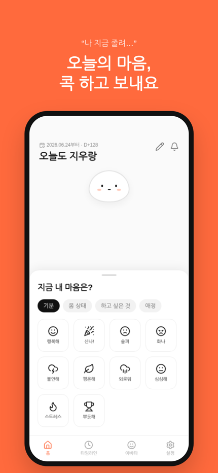
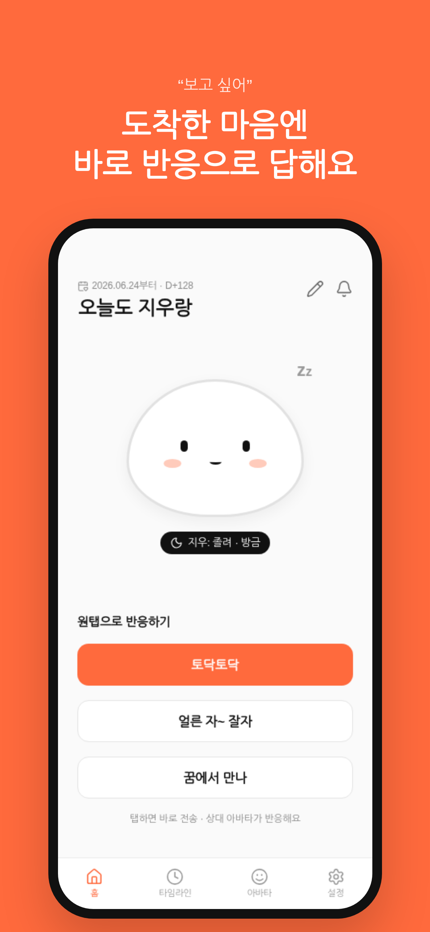
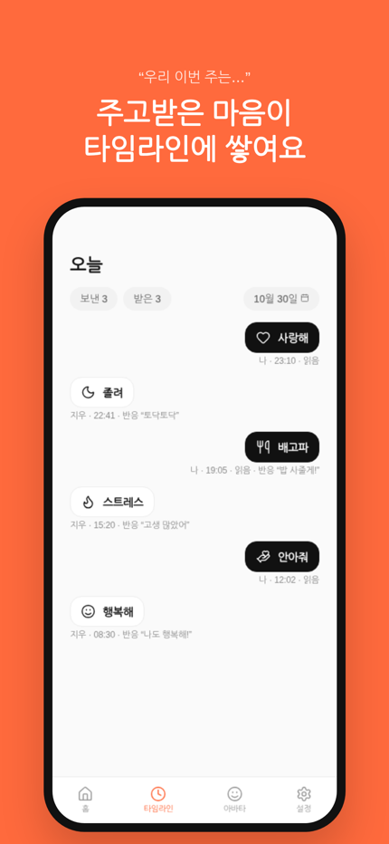

<p align="center">
  
</p>

<h1 align="center">마음콕</h1>
<p align="center"><b>말 안 해도 콕, 커플 감정 공유</b></p>

“배고파”, “졸려”, “보고 싶어”… 말로 꺼내기 애매한 순간, 버튼 하나만 콕 누르면 상대 화면의 내 아바타가 그 감정으로 움직이고 진동으로 바로 알려 주는 **둘만을 위한 감정 공유 앱**입니다.

<p align="center">
  
  
  
</p>

## 주요 기능
- **둘만 연결**: 초대 코드로 한 사람과만 연결 (24시간 유효, 양쪽 확인)
- **감정 40가지**: 라인 아이콘 그리드에서 콕 → 감정별 진동 패턴 + 푸시 알림
- **움직이는 아바타**: 떡 블롭 아바타를 몸 색·눈·입·볼터치·소품으로 꾸미고, 받은 감정에 맞춰 모션 재생 (idle·눈 깜빡임 포함)
- **원탭 반응**: 받은 감정에 감정별 반응 버튼으로 답장, 읽음 표시
- **타임라인**: 주고받은 감정과 반응을 날짜별로 모아 보기
- **우리만의 상단 문구**: 문구와 사귄 날짜(D-day) 개인 설정
- **로그인**: Google, Apple / 계정 삭제 지원

## 기술 스택
- Flutter (Android · iOS)
- Firebase: Authentication, Cloud Firestore(보안 규칙으로 커플 연결 검증), Cloud Messaging, Cloud Functions(Node 22), Hosting
- 아바타: SVG 파츠 + `flutter_svg`, 디자인 JSON 키프레임 모션 플레이어, `flutter_animate`
- CI: GitHub Actions → TestFlight (App Store Connect API 키 자동 서명)

## 문서
- 데이터 모델: [docs/data-model.md](docs/data-model.md)
- iOS 배포: [docs/ios-release.md](docs/ios-release.md)
- 개인정보처리방침: https://maeumkok.web.app/privacy.html
- 계정 삭제 안내: https://maeumkok.web.app/delete-account.html

## 개발
```bash
flutter pub get
flutter run
```
릴리스 서명 키와 API 키는 저장소에 포함되지 않습니다.
